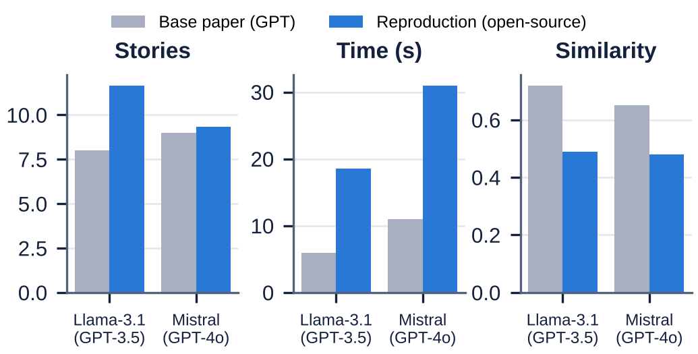

# A Generative AI and Large Language Model-Based Framework for Automated Software Requirements Prioritization

Code and results for the research paper by **Kamran Saeed** and **Dr. Akhtar Jamil**
(Department of Computer Science, FAST-NUCES, Islamabad, Pakistan).

The project studies whether **open-source large language models (LLMs)** can prioritize software
requirements reliably, and how hallucinated, missing or duplicated requirements in their output can be reduced.

| | |
|---|---|
| **Models** | Llama-3.1-8B, Mistral-7B, Qwen2.5-7B (open-source, run locally with Ollama) |
| **Techniques** | 100-Dollar, WSJF, AHP |
| **Base paper** | Sami et al., *Early Results of an AI Multiagent System for Requirements Elicitation and Analysis*, PROFES 2024, LNCS 15452, pp. 307–316, doi: [10.1007/978-3-031-78386-9_20](https://doi.org/10.1007/978-3-031-78386-9_20) |

---

## Repository status

| Part | Status |
|---|---|
| Part 1 – Reproduction of the base paper with open-source LLMs | ✅ Available |
| Part 2 – Proposed hallucination-aware framework (implementation and results) | ⏳ To be added |

---

## Part 1 – Reproduction of the base paper

The multi-agent system of the base paper (Product Owner, Quality Assurance, Developer and Manager agents)
was reimplemented and run on the paper's Supplier Data Management Platform (SDMP) project.
The proprietary models of the base paper were replaced with open-source models:

| Base paper | This reproduction |
|---|---|
| GPT-3.5 | Llama-3.1-8B |
| GPT-4o | Mistral-7B |

### Results (mean of 3 runs, temperature 0.7)

| Metric | GPT-3.5 (paper) | Llama-3.1-8B | GPT-4o (paper) | Mistral-7B |
|---|---|---|---|---|
| User stories | 8 | 11.67 | 9 | 9.33 |
| Response time (s) | 5.91 | 18.57 | 11.00 | 31.01 |
| Semantic similarity to description | 0.72 | 0.49 | 0.65 | 0.48 |
| Format compliance | – | 1.00 | – | 0.67 |
| All INVEST criteria met | – | 0.74 | – | 0.74 |
| Run-to-run Kendall's τ (ranking) | – | 0.741 | – | 0.816 |
| Kendall's τ between the two models | 0.87* | 0.625 | | |

\* computed from the ranks reported in Table 2 of the base paper.

### How to run

1. Open `notebooks/1_PROFES2024_Reproduction_Colab.ipynb` in [Google Colab](https://colab.research.google.com/).
2. Select **Runtime → Change runtime type → T4 GPU**.
3. Select **Runtime → Run all**. The notebook installs Ollama, downloads the open-source models and runs the
   three-step pipeline (generation, quality check against INVEST, 100-Dollar prioritization).
4. Results are written to the `profes_results` folder and downloaded as a zip.

No API key is needed. If an OpenAI key is stored in Colab Secrets as `OPENAI_API_KEY`, the notebook can
optionally use the original GPT models instead.

### Result files (`results/reproduction/`)

| File | Content |
|---|---|
| `generation.json` | Generated and INVEST-enhanced user stories for every run |
| `prioritization.json` | Agent and manager prioritizations (100-Dollar) for every run |
| `table_generation_runs.csv` | Per-run story count, response time, similarity, format and INVEST compliance |
| `table2_prioritization.csv` | Final ranks of the user stories (as Table 2 of the base paper) |
| `figure3_values.csv`, `figure3_reproduction.png` | Values and plot comparing with Figure 3 of the base paper |
| `summary.json` | Summary of all reproduction metrics and the models used |

---

## Citation

If you use this repository, please cite the base paper above and this work (citation to be added after publication).

## License

Code is released under the MIT License. The base paper and any datasets remain the property of their authors.
